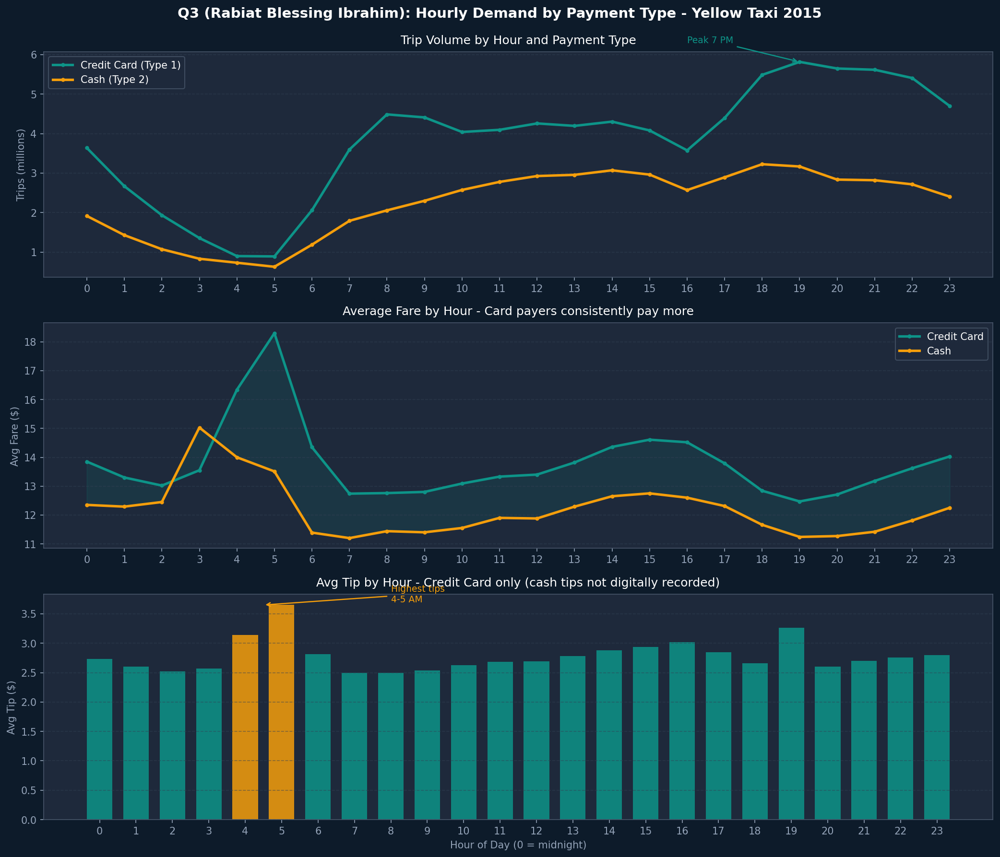
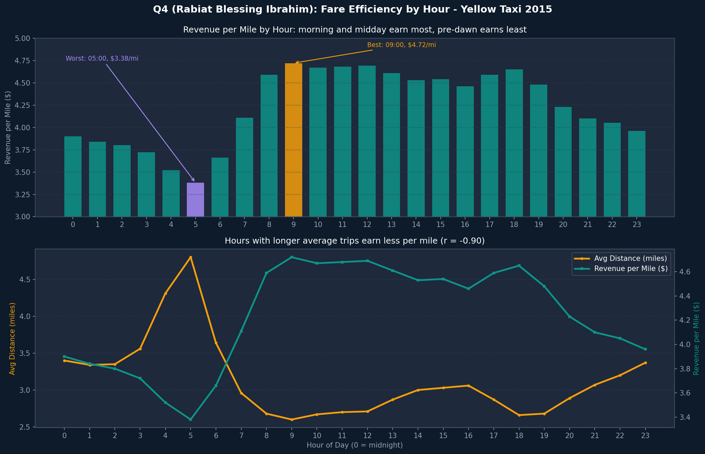

# NYC Yellow Taxi 2015: SQL Analysis at Scale with Google BigQuery

Six SQL queries on 146 million New York City yellow taxi trips from 2015, run in Google BigQuery and visualized in Python. Each query answers one business question about demand, pricing, tipping, or rider behavior.

**Tech:** Google BigQuery (SQL), Python (pandas, matplotlib), Google Colab

**Dataset:** [`bigquery-public-data.new_york.tlc_yellow_trips_2015`](https://console.cloud.google.com/bigquery?p=bigquery-public-data&d=new_york&t=tlc_yellow_trips_2015&page=table), NYC Taxi and Limousine Commission trip records in Google Cloud Public Datasets

## Team

A group project for ALY 6110: Data Management and Big Data at Northeastern University (Vancouver), Group 8. Each member wrote, ran, and analyzed two queries.

| Query | Author | Business question |
| --- | --- | --- |
| [Q1](sql/q1_monthly_demand_revenue.sql) | Haonan Zhang | How did yellow taxi demand and revenue change across 2015? |
| [Q2](sql/q2_tips_by_distance.sql) | Haonan Zhang | Do longer trips receive better tips? |
| [Q3](sql/q3_hourly_demand_by_payment.sql) | **Rabiat Blessing Ibrahim** | Do credit card and cash passengers behave differently across the day? |
| [Q4](sql/q4_revenue_per_mile_by_hour.sql) | **Rabiat Blessing Ibrahim** | When are taxi trips most profitable per mile? |
| [Q5](sql/q5_solo_vs_group_by_hour.sql) | Jennifer Flora Bastian | Which hours are most popular for solo vs. group trips? |
| [Q6](sql/q6_weekday_vs_weekend.sql) | Jennifer Flora Bastian | How do weekday and weekend trips differ in fare, distance, and tipping? |

## Repository layout

```
nyc-taxi-bigquery-analysis/
├── README.md
├── sql/          One file per query, ready to paste into the BigQuery console
├── results/      Query output exported from BigQuery as CSV
├── charts/       One chart per query
└── notebooks/
    └── nyc_taxi_analysis.ipynb   Analysis and charts for all six queries
```

## Q3: Hourly demand by payment type

Groups trips by pickup hour and payment type. The dataset stores `payment_type` as a STRING, so the filter is `payment_type IN ('1', '2')` with quoted values. Unquoted integers cause a type error.



- **Card payments dominate:** 63% of trips (91.6M) were paid by card and 37% (53.8M) in cash.
- **Card trips cost more:** weighted by trip volume, the average card fare was $13.48 and the average cash fare was $12.01, a gap of $1.47 per trip.
- **Cash tips are invisible:** cash tips show $0 at every hour because drivers don't record them. Any tip analysis on this dataset only reflects card payers.
- **Card tips peak before dawn:** the highest average card tip is at 5 AM ($3.65), which is also the hour with the highest average card fare ($18.30).

## Q4: Revenue per mile by hour

Measures how much fare a trip earns for each mile driven, by pickup hour. The main measure, `revenue_per_mile`, is total fare divided by total miles. The query also reports the average of each trip's own fare-per-mile, which very short trips push upward.



- **Best hour:** 9 AM, at $4.72 per mile.
- **Worst hour:** 5 AM, at $3.38 per mile, a gap of $1.34.
- **Longer trips earn less per mile:** across the 24 hours, average trip distance and revenue per mile have a correlation of -0.90. The 5 AM hour has the longest average trips of the day (4.8 miles) and the lowest revenue per mile. A likely reason is that the fixed part of each fare is spread over more miles on a longer trip.

### Fixing a data quality problem in Q4

The first version of Q4 filtered only `trip_distance > 0`. Its hourly average distances ranged from 5 to 37 miles, even though a typical trip in this dataset is about 3 miles (Q6, which caps distance at 50 miles, averages 2.96). A small number of rows with impossible distances were dragging every average up. Because of this, the first version's correlation between distance and fare per mile was +0.03, which didn't support the "longer trips earn less per mile" finding at all.

Adding `trip_distance <= 50`, the same cap Q6 uses, removed 6,842 trips (about 0.005% of the data). Average distances dropped to a realistic 2.6 to 4.8 miles, and the inverse relationship became clear. The query also gained `revenue_per_mile` as a more reliable measure than averaging per-trip ratios.

## Team findings

**Q1 (Haonan Zhang):** 146.0M trips and $2.35B in total revenue across 2015. Demand peaked in March (13.3M trips) and was lowest in August (11.1M). The average trip total rose from $15.12 in January to $16.53 in October.

**Q2 (Haonan Zhang):** tip percentage rises slightly with distance, from 8.9% for trips under 1 mile to 10.1% for trips over 10 miles. Trips of 1 to 3 miles are the most common (72.5M, about half of all trips). The 10+ mile group has an average distance of 211.69 miles, which flags outlier rows in that group.

**Q5 (Jennifer Flora Bastian):** solo riders take 70.5% of trips (102.9M), and both solo and group demand peak at 7 PM.

**Q6 (Jennifer Flora Bastian):** weekdays account for 103.0M trips and weekends for 42.1M. The average weekday fare ($12.99) is slightly higher than the weekend fare ($12.60), even though weekend trips are slightly longer (3.05 vs. 2.96 miles).

Full charts for all six queries are in [`charts/`](charts/).

## How to reproduce

1. Open the [BigQuery console](https://console.cloud.google.com/bigquery). The free BigQuery sandbox works and needs no billing account.
2. Paste any file from `sql/` into a new query tab and run it. Each query scans a few GB, well within the sandbox's free monthly limit.
3. Compare the output with the matching CSV in `results/`.
4. To rebuild the charts, open `notebooks/nyc_taxi_analysis.ipynb` in Jupyter or Google Colab and run all cells. The notebook reads the exported results, so it doesn't need BigQuery access.

## Limitations

- The notebook works from results exported out of BigQuery, not a live connection, so rerunning a query means updating its results block in the notebook.
- Q2 does not cap trip distance, so its 10+ mile group still includes the outlier rows it flags.
- The Q4 correlation is calculated across 24 hourly averages, not individual trips. It shows that hours with longer trips earn less per mile, which is not the same as measuring every trip.
- Cash tips are not recorded, so tip findings only describe card-paying passengers.
- The data covers 2015 only.
